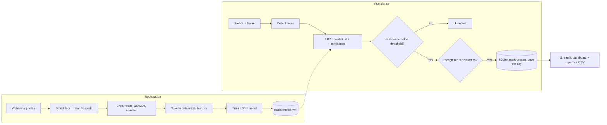

# 🧑‍💻 Face Recognition Attendance System

A complete **Python** attendance system that recognises students by their face through a webcam and marks attendance automatically. It includes webcam registration, live recognition, a SQLite database and a **Streamlit dashboard** with reports and CSV export.

Built with **OpenCV** (Haar Cascade face detection + LBPH face recognition), **SQLite** and **Streamlit**.

---

## 📌 Table of Contents
- [Features](#-features)
- [Tech Stack](#-tech-stack)
- [How It Works](#-how-it-works)
- [AI / Computer Vision Concepts](#-ai--computer-vision-concepts)
- [Project Structure](#-project-structure)
- [Installation](#-installation)
- [Usage (Step by Step)](#-usage-step-by-step)
- [Configuration](#-configuration)
- [Database Schema](#-database-schema)
- [Tips for Better Accuracy](#-tips-for-better-accuracy)
- [Privacy Note](#-privacy-note)
- [Troubleshooting](#-troubleshooting)
- [Future Improvements](#-future-improvements)
- [Author](#-author)

---

## ✨ Features

| Module | Description |
|---|---|
| 📷 Webcam registration | Captures 40 face samples per student and trains the model automatically |
| 🎥 Live attendance | Recognises faces in real time and marks students present |
| 🛡 Duplicate protection | A student is marked **once per day** only |
| ✅ Stable recognition | A face must be recognised for several consecutive frames before marking (avoids false marks) |
| ❓ Unknown detection | Unregistered faces are shown as "Unknown" |
| 📅 Today dashboard | Present / absent lists and counts |
| 📊 Reports | Date-range report, attendance percentage per student, bar chart, CSV export |
| 👥 Student management | Register by photo upload or camera snapshot, delete students |
| 📸 Photo attendance | Take attendance from a snapshot or a class photo in the browser |
| 💾 Database | SQLite, no server needed |

---

## 🛠 Tech Stack

| Layer | Technology |
|---|---|
| Language | Python 3.9+ |
| Face detection | OpenCV Haar Cascade |
| Face recognition | OpenCV LBPH (Local Binary Patterns Histograms) |
| Database | SQLite (`sqlite3`) |
| Dashboard | Streamlit + pandas |

---

## ⚙️ How It Works



**Step by step**

1. **Register:** `register.py` opens the webcam, detects your face and saves 40 cropped grayscale samples in `dataset/<student_id>/`.
2. **Train:** All samples are used to train an LBPH recognizer. The model is saved to `trainer/model.yml`.
3. **Recognise:** `attendance.py` detects faces in every frame and asks the model for the closest student and a *confidence* value (in LBPH, **lower is better**).
4. **Decide:** If confidence is below the threshold (default 70) the face is accepted, otherwise it is "Unknown".
5. **Mark:** After the same face is recognised for 5 consecutive frames, attendance is saved in SQLite (once per day).
6. **Report:** The Streamlit dashboard reads the database and shows today's status, reports and downloads.

---

## 🧠 AI / Computer Vision Concepts

| Concept | Use in this project |
|---|---|
| **Haar Cascade** | Fast classical face detector |
| **LBPH** | Describes a face by local texture patterns and compares histograms |
| **Histogram equalization** | Reduces the effect of lighting changes |
| **Data augmentation** | Mirrored copies of photos used when registering from uploads |
| **Confidence threshold** | Separates known students from unknown people |
| **Temporal smoothing** | Needs N consecutive frames to avoid false positives |

---

## 📁 Project Structure

```
face-attendance/
├── config.py          # Paths and settings (threshold, sample count, ...)
├── database.py        # SQLite: students + attendance
├── face_utils.py      # Detection, preprocessing, training, recognition
├── register.py        # Register a student with the webcam
├── attendance.py      # Live webcam attendance
├── app.py             # Streamlit dashboard
├── requirements.txt
├── .gitignore
└── README.md

(auto-created when you run it)
├── dataset/           # Face samples  (private, not uploaded to Git)
├── trainer/model.yml  # Trained model
└── attendance.db      # Database
```

---

## 📥 Installation

**Requirements:** Python 3.9+, a webcam.

```bash
cd face-attendance

python -m venv venv
venv\Scripts\activate            # Windows
source venv/bin/activate         # Linux / macOS

pip install -r requirements.txt
```

> `opencv-contrib-python` is required (not plain `opencv-python`) because the LBPH recognizer lives in the `cv2.face` module.

---

## ▶️ Usage (Step by Step)

### 1. Register students (webcam)
```bash
python register.py
```
Enter the roll number and name, then look at the camera and slowly turn your head slightly. It captures 40 samples and trains the model. Press `q` to stop early. Repeat for every student.

Or non-interactive:
```bash
python register.py --roll 22-185 --name "Moiz"
```

### 2. Take attendance (live)
```bash
python attendance.py
```
Students look at the camera; recognised faces get a green box with their name and are marked present. Press `q` to quit.

### 3. Open the dashboard
```bash
streamlit run app.py
```
Opens at `http://localhost:8501` with four tabs:

| Tab | What you can do |
|---|---|
| 📅 Today | See present / absent, download today's CSV |
| 📊 Reports | Pick a date range, view attendance %, chart, logs and CSV |
| 👥 Students | Register by photos / snapshot, delete students |
| 📸 Take Attendance | Mark attendance from a browser snapshot or uploaded photo |

If `streamlit` is not recognized, use `python -m streamlit run app.py`.

---

## 🔧 Configuration

Edit `config.py`:

| Setting | Default | Meaning |
|---|---|---|
| `CONFIDENCE_THRESHOLD` | 70 | Lower = stricter. Lower it if wrong people are accepted; raise it if real students show as Unknown |
| `SAMPLES_PER_STUDENT` | 40 | Photos captured during registration |
| `CONSECUTIVE_FRAMES` | 5 | Frames needed before marking present |
| `MIN_FACE_SIZE` | (80, 80) | Ignores very small / distant faces |

---

## 🗄 Database Schema

```
students   (id PK, roll_no UNIQUE, name, created_at)
attendance (id PK, student_id FK -> students.id, date, time, UNIQUE(student_id, date))
```
The `UNIQUE(student_id, date)` rule guarantees one record per student per day.

---

## 🎯 Tips for Better Accuracy

- Register in the **same lighting** you will use for attendance
- Capture with and without glasses if the student wears them
- Face the camera directly; avoid strong backlight
- Use 40+ samples per student (re-run `register.py` for the same roll number to add more)
- Tune `CONFIDENCE_THRESHOLD` on your own data

---

## 🔒 Privacy Note

Face photos and attendance records are personal data. The `.gitignore` excludes `dataset/`, `trainer/` and `attendance.db`, so **never upload them to GitHub**. Only use this system with the consent of the people being registered.

---

## 🩺 Troubleshooting

| Problem | Solution |
|---|---|
| `module 'cv2' has no attribute 'face'` | `pip uninstall opencv-python` then `pip install opencv-contrib-python` |
| Webcam does not open | Close other apps using the camera, or change `VideoCapture(0)` to `1` |
| Face not detected | Improve lighting, move closer, face the camera |
| Real student shows as Unknown | Add more samples or raise `CONFIDENCE_THRESHOLD` (e.g. 80) |
| Wrong person accepted | Lower `CONFIDENCE_THRESHOLD` (e.g. 60) and add more samples |
| `No trained model` message | Register at least one student first |
| `'python' is not recognized` | Reinstall Python and tick **Add Python to PATH** |

---

## 🔮 Future Improvements

- Deep-learning recognition (FaceNet / `face_recognition` / InsightFace) for higher accuracy
- Liveness / anti-spoofing check (blocks photo-of-a-photo attacks)
- Multiple classes and subjects, teacher login
- Email / WhatsApp notification for absentees
- Cloud database and a mobile-friendly web app

---

## 👤 Author

**Malik Moiz Ahmad Awan**
BS Computer Science, University of Gujrat

## 📄 License

This project is for educational purposes. Free to use and modify.
